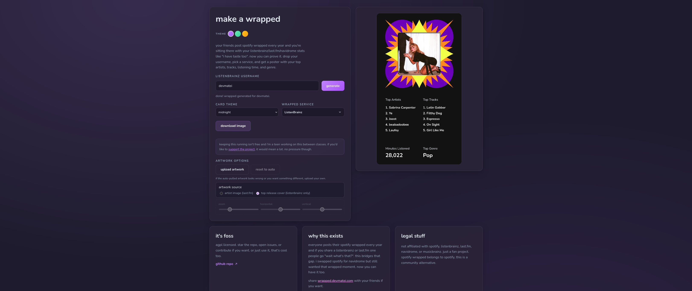

<div align="center">

# 🎧 make a wrapped

**spotify wrapped style recaps for listenbrainz, last.fm, libre.fm and navidrome.**<br>
free, open source, no account, and you don't have to wait for december.

<a href="https://github.com/DevMatei/make-a-wrapped/stargazers"></a>
<a href="https://github.com/DevMatei/make-a-wrapped/network/members"></a>
<a href="https://github.com/DevMatei/make-a-wrapped/issues"></a>
<a href="https://github.com/DevMatei/make-a-wrapped/commits"></a>
<a href="./LICENSE"></a>
<br>
<a href="https://wrapped.devmatei.com"></a>
<a href="https://wrapped.devmatei.com"></a>
<a href="https://discord.gg/ucFGpJdznF"></a>
<br>
<a href="https://ko-fi.com/F1F016B4WM"></a>
<a href="https://sponsor.devmatei.com/"></a>

<a href="https://wrapped.devmatei.com"><b>make yours</b></a> ·
<a href="./docs/API.md"><b>api docs</b></a> ·
<a href="#-templates-beta"><b>templates</b></a> ·
<a href="#-self-hosting"><b>self-host</b></a> ·
<a href="#-support-it"><b>support it</b></a>

there's a [discord](https://discord.gg/ucFGpJdznF) too, come say hi, post your wrapped, report bugs, whatever

<br>



</div>

## 💡 what it does

* **four services:** listenbrainz, last.fm, libre.fm and navidrome. public stats need no login, and navidrome runs fully in your browser so your server password never touches mine
* **any time frame:** this year, last year, last 12 months, this month, last month, a specific month or all time. no waiting for december
* **artist art that actually shows up:** tries last.fm first, then musicbrainz and wikidata. if all of that fails, upload your own and zoom/position it by hand
* **templates:** built-in themes plus community ones from the [template library](https://wrapped.devmatei.com/marketplace), and a [visual editor](https://wrapped.devmatei.com/editor) to make your own without touching code (both **beta**)
* **readme badges:** your top artist, track, genre or minutes as a live svg for your github profile
* **an api:** render posters server side from your own app ([docs](./docs/API.md))
* **self-hostable:** one docker compose file, rate limits so your box doesn't get nuked, and optional multi server failover
* officially listed on the [listenbrainz enabled applications](https://wiki.musicbrainz.org/ListenBrainz_Enabled_Applications) page :D

> [!NOTE]
> **libre.fm** support is **beta**. libre.fm throttles hard per ip and its api is less predictable than last.fm's, so it can be slow or flaky. treat it as experimental.

## 🏷️ readme badges

put your top artist on your github profile or website. it's a live svg, cached server side for a few hours so it won't hammer anything:

```markdown

```

| param | values | default |
| --- | --- | --- |
| `type` | `artist`, `track`, `genre`, `minutes` | `artist` |
| `service` | `listenbrainz`, `lastfm`, `librefm` | `listenbrainz` |
| `range` | `this_year`, `last_year`, `last_12_months`, `this_month`, `last_month`, `all_time` | `this_year` |
| `color` | hex without the `#` | `c084fc` |

```markdown

```

**navidrome badges** work differently, since your server credentials never touch this app. make your wrapped, hit "copy readme badge", and your browser publishes just the final numbers (top artist, track, genre, minutes, nothing else) under a private key kept in your browser. the badge url stays the same when you regenerate, only you can update it, and it expires after 60 days unless you refresh it.

## 🔌 developer api (beta)

turn stats into a finished poster from your own app. no account, no api key, png or svg back:

```sh
curl --fail-with-body https://wrapped.devmatei.com/api/v1/wrapped \
  -H 'Content-Type: application/json' \
  -d '{"source": {"type": "provider", "provider": "listenbrainz", "username": "YOUR_USERNAME"}}' \
  --output wrapped.png
```

there's also a read-only template catalog with preview images, so you can show the library on your own site. everything is in the [api guide](./docs/API.md).

## ☕ support it

make a wrapped is free, has no paywalls and no accounts, and it's going to stay that way. it runs on my homelab, which still costs power, a domain and a lot of my free time (i'm broke lol). if it gave you a good wrapped, a coffee genuinely helps keep it online.

<a href="https://ko-fi.com/F1F016B4WM"></a>

no money? a ⭐ on the repo, a bug report, or posting your wrapped in the [discord](https://discord.gg/ucFGpJdznF) helps too.

## 📣 advertise here

there's a small ad slot on the site and it's cheap. if you've got a project, a tool or a server music nerds would like, [grab a spot on sponsor.devmatei.com](https://sponsor.devmatei.com/). it shows up next to the generator and the money goes straight into hosting.

## ⚡ self-hosting

### docker (easiest)

```bash
git clone https://github.com/DevMatei/make-a-wrapped.git && cd make-a-wrapped
cp .env.example .env    # add your LASTFM_API_KEY at least
docker compose up -d
```

the app ends up on port `8000` (change it in `docker-compose.yml`). compose also starts a small redis so rate limits are shared between workers, and keeps counters, uploads and approved templates in `./data`.

### bare metal

needs python 3 and, for the api and template previews, node 20+.

```bash
python3 -m venv .venv && source .venv/bin/activate
pip install -r requirements.txt
npm ci
cp .env.example .env
```

then either run the dev server (port comes from `PORT`, default `5000`):

```bash
python wrapped-fm.py
```

or gunicorn for real traffic:

```bash
gunicorn -w 4 -b 0.0.0.0:8000 wrapped-fm:app
```

with more than one worker, set `RATE_LIMIT_STORAGE` to a redis url, otherwise every worker keeps its own rate limit counts.

## ⚙️ config

everything goes in `.env`. [`.env.example`](./.env.example) has the common ones filled in, and every value has a sane default, so you only really need `LASTFM_API_KEY`.

<details>
<summary><b>services and integrations</b></summary>

| var | default | what it does |
| --- | --- | --- |
| `LASTFM_API_KEY` | none | needed for last.fm stats and better artist images |
| `LIBREFM_API_KEY` | a built-in key | libre.fm takes any key for reads, but a real one identifies your app |
| `LISTENBRAINZ_API` | `https://api.listenbrainz.org/1` | |
| `LASTFM_API` | `https://ws.audioscrobbler.com/2.0/` | |
| `LIBREFM_API` | `https://libre.fm/2.0/` | |
| `MUSICBRAINZ_API` | `https://musicbrainz.org/ws/2` | |
| `COVER_ART_API` | `https://coverartarchive.org/release` | |
| `LISTENBRAINZ_USER_AGENT`, `MUSICBRAINZ_USER_AGENT`, `LASTFM_USER_AGENT`, `LIBREFM_USER_AGENT` | `make-a-wrapped/1.0 (...)` | be nice and put your own contact in these if you self-host |
| `SITE_URL` | `https://wrapped.devmatei.com` | public url, used for seo tags and api links |
| `HTTP_PROXY`, `HTTPS_PROXY`, `NO_PROXY` | none | picked up automatically if you tunnel through a proxy |

</details>

<details>
<summary><b>stats and artwork</b></summary>

| var | default | what it does |
| --- | --- | --- |
| `LISTENBRAINZ_RANGE` | `this_year` | default time frame |
| `AVERAGE_TRACK_LENGTH_MINUTES` | `3.5` | fallback average track length for minutes listened |
| `AVERAGE_TRACK_SAMPLE_LIMIT` | `50` | |
| `COVER_ART_LOOKUP_LIMIT` | `15` | |
| `LIBREFM_MIN_INTERVAL` | `2.0` | seconds between libre.fm calls |
| `LIBREFM_DURATION_LOOKUP_LIMIT` | `3` | |
| `TEMP_ARTWORK_TTL_SECONDS` | `3600` | how long uploaded artwork lives on the server |
| `TEMP_ARTWORK_MAX_BYTES` | `6291456` (6 mb) | |
| `TEMP_ARTWORK_DIR` | `data/tmp-artwork` | |

</details>

<details>
<summary><b>performance and rate limits</b></summary>

| var | default | what it does |
| --- | --- | --- |
| `APP_RATE_LIMIT` | `90 per minute` | general per-ip limit |
| `APP_STATS_RATE_LIMIT` | `45 per minute` | stats and badge endpoints |
| `APP_IMAGE_RATE_LIMIT` | `15 per minute` | artwork and `POST /api/v1/wrapped` |
| `APP_CATALOG_RATE_LIMIT` | `120 per minute` | template catalog api |
| `APP_PREVIEW_RATE_LIMIT` | `240 per minute` | template preview images |
| `APP_MAX_TOP_RESULTS` | `15` | |
| `APP_IMAGE_CONCURRENCY`, `APP_IMAGE_QUEUE_LIMIT`, `APP_IMAGE_QUEUE_TIMEOUT` | `2`, `10`, `15` | artwork fetch queue |
| `APP_API_RENDER_CONCURRENCY`, `APP_API_RENDER_QUEUE_LIMIT`, `APP_API_RENDER_QUEUE_TIMEOUT` | `1`, `16`, `30` | api render queue, per worker |
| `RATE_LIMIT_STORAGE` | `memory://` | set to a redis url when running several workers |
| `APP_RATE_LIMIT_SALT` | empty | set something random, it salts the hashed client ips |
| `APP_TRUST_PROXY_HEADERS` | `0` | set to `1` only behind a reverse proxy you control |
| `HTTP_TIMEOUT`, `HTTP_POOL_MAXSIZE` | `10`, `40` | |
| `LISTENBRAINZ_CACHE_TTL`, `LISTENBRAINZ_CACHE_SIZE` | `60`, `256` | |
| `LOG_LEVEL` | `INFO` | |

</details>

<details>
<summary><b>counters, badges and templates</b></summary>

| var | default | what it does |
| --- | --- | --- |
| `COUNTER_DB` | `data/counters.db` | sqlite file for the wrapped counter and template uses |
| `WRAPPED_COUNT_FILE` | `data/wrapped-count.txt` | old counter file, imported once on first start |
| `WRAPPED_COUNT_SINCE` | `2025-10-26` | label for when you started counting |
| `BADGE_CACHE_TTL`, `BADGE_CACHE_SIZE` | `21600` (6h), `512` | |
| `BADGE_SNAPSHOT_DIR` | `data/badges` | navidrome badge snapshots |
| `BADGE_SNAPSHOT_TTL_SECONDS`, `BADGE_SNAPSHOT_MAX_COUNT` | 60 days, `20000` | |
| `TEMPLATE_REVIEW_KEY` | none | enables `/admin` and the review api. leave empty to disable moderation |
| `TEMPLATE_LIBRARY_DIR` | `data/templates` | approved community templates |
| `TEMPLATE_SUBMISSION_DIR`, `TEMPLATE_CREATOR_DIR`, `TEMPLATE_ASSET_DIR` | `data/template-*` | |
| `TEMPLATE_ASSET_MAX_BYTES` | `10485760` (10 mb) | |
| `TEMPLATE_PREVIEW_DIR` | `data/template-previews` | cached catalog previews |
| `TEMPLATE_CATALOG_TTL` | `30` | seconds before the catalog is rebuilt |
| `TURNSTILE_SITE_KEY`, `TURNSTILE_SECRET_KEY` | none | optional cloudflare turnstile on template submissions and uploads |

</details>

### running more than one server

handy if you want a backup box for when the main one goes down. leave all of this empty for a single server.

| var | what it does |
| --- | --- |
| `NODE_ID` | unique name for each box |
| `CLUSTER_SECRET` | same on every box |
| `CLUSTER_PEERS` | the other boxes' base urls, comma separated. use private addresses (tailscale, wireguard), not the public site url, or a box can end up talking to itself |
| `CLUSTER_PRIMARY` | the primary's url, set on every box except the primary |
| `CLUSTER_SYNC_INTERVAL` | seconds between syncs, default `60` |

the primary owns template submissions, uploads and the review desk. what syncs:

* **counters:** each box counts its own wraps and template uses and pulls the others about once a minute, so totals match and nothing is lost if a box is down
* **artwork and navidrome badges:** a box that doesn't have one asks the others
* **templates:** approved templates and their images get copied from the primary. submissions and reviews on other boxes get forwarded to it. while the primary is down, wrapped generation keeps working and submissions say to try again later

boxes talk over `/internal/*` with the secret. nothing in there is useful to the public, so you can block that path at your proxy.

## 🎨 templates (beta)

templates are small json documents: official ones live in `static/templates/`, approved community ones in `data/templates/`. the renderer reads the same format everywhere, so anything made in the editor works just like the built-in themes.

| page | what it's for |
| --- | --- |
| [`/templates`](https://wrapped.devmatei.com/templates) | what templates are and how to use them |
| [`/marketplace`](https://wrapped.devmatei.com/marketplace) | browse, search, filter by category, sort by featured/newest/popular, export as json, or "use this template" to jump into the generator |
| [`/editor`](https://wrapped.devmatei.com/editor) | the visual editor. place and style text, lists, stats, background and artwork on a live canvas, then submit it for review |
| `/admin` | moderation. submissions stay `pending_review` until a maintainer approves them |

creators are identified by a key kept in their browser (same idea as the navidrome badges), so you can submit as many templates as you want without an account, and nobody can casually claim to be you.

## 🤝 contributing

prs welcome, into `develop`. see [CONTRIBUTING.md](./.github/CONTRIBUTING.md) for setup and the checklist. tl;dr: keep prs focused, run the tests, and attach screenshots for ui changes. found a security bug? please report it privately, see [SECURITY.md](./SECURITY.md).

## 🙋 why it exists

i self-host my music library on navidrome and don't use spotify, but all my friends post their wrapped every year and everyone's like "wait what's that?" when you show them a listenbrainz stats page. so i built this. same vibe, works with open music platforms.

originally made for last.fm only by [jeff parla](https://github.com/parlajatwit) <3

i'm matei ([devmatei](https://devmatei.com)), full-stack dev from moldova. i build random web tools, run a homelab full of self-hosted stuff, and care way too much about my music library. more projects at [devmatei.com](https://devmatei.com).

## ⭐ star history

<div align="center">

<a href="https://www.star-history.com/?repos=devmatei%2Fmake-a-wrapped&type=date&legend=top-left">
 <picture>
   <source media="(prefers-color-scheme: dark)" srcset="https://api.star-history.com/chart?repos=devmatei/make-a-wrapped&type=date&theme=dark&legend=top-left&sealed_token=hqKtGOCKpuhqdJ4EGwzj7IO3Br7w8APo1cS5gbEa2Qjc09c7d_5G0LbhnmPzV7xYM1VVayE0IifWD_IUBifA5HSAdm33mKRu8nmp43tqSyUbOshG1oHCug" />
   <source media="(prefers-color-scheme: light)" srcset="https://api.star-history.com/chart?repos=devmatei/make-a-wrapped&type=date&legend=top-left&sealed_token=hqKtGOCKpuhqdJ4EGwzj7IO3Br7w8APo1cS5gbEa2Qjc09c7d_5G0LbhnmPzV7xYM1VVayE0IifWD_IUBifA5HSAdm33mKRu8nmp43tqSyUbOshG1oHCug" />
   
 </picture>
</a>

</div>

## 📜 license

[agpl-3.0](./LICENSE), share alike. if you run a modified version publicly, share your changes.

not affiliated with spotify, listenbrainz, last.fm, libre.fm, navidrome or musicbrainz. just a fan thing built for fun.

<div align="center">
<br>

if this made you smile, [buy me a coffee](https://ko-fi.com/F1F016B4WM) or just ⭐ the repo. both make my day.

<sub>made with too many scrobbles by <a href="https://devmatei.com">devmatei</a> · <a href="https://wrapped.devmatei.com">wrapped.devmatei.com</a> · <a href="https://ko-fi.com/F1F016B4WM">ko-fi</a> · <a href="https://discord.gg/ucFGpJdznF">discord</a> · <a href="https://sponsor.devmatei.com/">advertise</a></sub>
</div>
